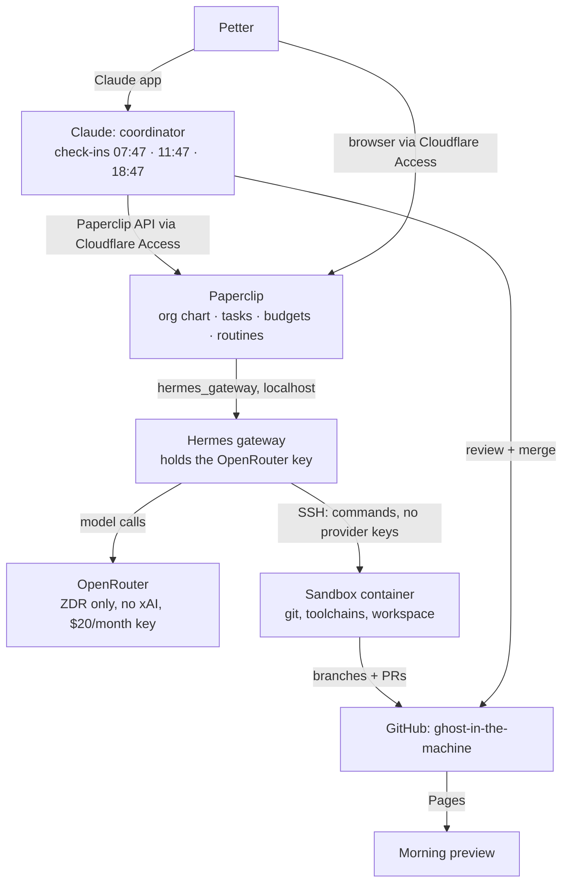

# Design

## What this is for

Petter runs a small fleet of AI agents on the same Hetzner VM as
flight-tracker. Claude, in Claude Code sessions on Petter's plan, coordinates
them: it writes briefs, reviews work, merges, and reports. Cheap models
on OpenRouter do the bulk of the work:

- **Nightly builder:** each night, picks a language and an idea it hasn't done
  before, builds a small app in `ghost-in-the-machine`, and leaves a preview
  link for the morning.
- **Researcher:** research tasks and reports.
- **Coder:** small fixes and first drafts in `ghost-in-the-machine`.
- **Ops:** read-only watch over the VM; reports to the coordinator.
- **Backup coordinator:** keeps work moving when Claude is unavailable.

## Architecture

| Container | Image | Memory cap | Notes |
|---|---|---|---|
| `postgres` | `postgres:17-alpine` (digest pinned) | 256 MB | Paperclip's database |
| `paperclip` | `ghcr.io/paperclipai/paperclip:2026.1023.0` (digest pinned) | 768 MB | UI and API on `127.0.0.1:3100`; cloudflared publishes it as `agents.pastabake.cloud` |
| `hermes` | `nousresearch/hermes-agent:v0.22.5` (digest pinned) | 512 MB | Gateway API on port 8642. It shares `paperclip`'s network namespace, so Paperclip reaches it on loopback, the only plain-HTTP target Paperclip allows. |
| `sandbox` | built from `sandbox/Dockerfile` | 1.5 GB, 1.5 CPU | Where agent commands run, reached over SSH. Holds the GitHub token, never the OpenRouter key. |

**Memory.** The VM has 3.8 GB of RAM and 4 GB of swap. Flight-tracker uses about
0.6–0.8 GB after #132, and the OS plus cloudflared about 0.4 GB. The caps add
up to 3 GB, but they are ceilings, not usage: idle, the stack should sit around
1–1.5 GB. Builds that spike use swap. `vm.swappiness=10` keeps flight-tracker in
RAM. Every container is capped, so a runaway build is OOM-killed inside its
container and can't take flight-tracker with it. The coordinator watches
`/api/ops/stats` and flags pressure.

## Models (OpenRouter, ZDR endpoints only)

| Use | Model | $/M tokens in / out |
|---|---|---|
| Default for every agent | `deepseek/deepseek-v4.1-flash` | 0.05 / 0.19 |
| Fallback 1, backup coordinator | `z-ai/glm-5.3-flash` | 0.15 / 0.50 |
| Fallback 2 | `minimax/minimax-m3` | 0.30 / 1.20 |
| Fallback 3 (Claude via Bedrock/Vertex) | `anthropic/claude-haiku-5.5` | 0.10 / 0.50 |

These were chosen from OpenRouter's ZDR endpoint list on 2026-10-26.
Harness-Bench (arXiv 2605.27922) scored Hermes with DeepSeek-V4-Flash and
GLM-5.3-Flash at about 67, level with frontier models in other harnesses. The
best harness depends on the model, so the coder agent may move to OpenCode
later. Paperclip supports it, and the switch is per agent.

Account settings, done 2026-10-26:
- ZDR enforced for all providers. Google is "safety retention allowed", so Gemini stays available through Vertex.
- No training, no data sharing.
- The key has a $20 monthly budget.

**No xAI models.** That's Petter's choice: SpaceXAI ZDR is on, `provider_routing.ignore`
lists `x-ai`, and no config names an `x-ai/*` model.

## Rules

- **Server agents never merge.** They push branches and open PRs, and the
  coordinator reviews and merges. `ghost-in-the-machine`'s `main` is protected
  by a ruleset with no bypass, so a push straight to `main` fails even with
  Petter's token.
- **Agents can reach one repo only.** A fine-grained token covers `ghost-in-the-machine`
  alone, with contents, PRs and issues read/write and Actions and statuses
  read. It has no Workflows or Administration rights, so agents can't change
  CI or settings. Flight-tracker stays with the coordinator, because a push to
  its `main` deploys to production.
- **Secrets never land in git.** The sandbox has no model keys. GitHub push
  protection is on, and a pre-push hook and CI run gitleaks. Every repo is
  public.
- **Patch rule (Petter's):** a major CVE (CVSS 7+ or CISA KEV) in anything
  running gets patched no sooner than 24 h and no later than 72 h after the fix
  is released. Images are pinned by digest, and updates come in through
  Dependabot PRs, merged only once the release is 24 h old.
- **Budgets:** the OpenRouter key stops at $20 a month. Paperclip budgets are set
  per agent (see `agents/README.md`), so one agent can't use up the month.
- **Ops is read-only.** It reports; changes go through the coordinator and Petter.

## Nightly builder routine

At 01:00 Stockholm, a Paperclip routine creates a task for the nightly builder:

1. Read `ghost-in-the-machine/LOG.md`, the history of past nights (language,
   idea, verdict, Petter's feedback), and pick a language and app idea not done
   before. Relaxing, enjoyable apps are the default theme.
2. Sparse-clone: `git clone --filter=blob:none --sparse`, then
   `git sparse-checkout set <night-folder>`.
3. Build in `nights/YYYY-MM-DD-<slug>/` with a README (idea, language, how
   to run), a build script, and a static web build if the language allows it
   (WebAssembly, JS output), so it can be previewed on Pages.
4. Open a PR with a summary and screenshots. The coordinator's morning
   check-in reviews it, merges if it's sound, and sends Petter the preview link.
5. Append the night to `LOG.md` and stop. If it runs out of budget, it stops
   and says why.

Petter's feedback goes into `LOG.md` and shapes the following nights.

## Coordinator interface

Claude reaches Paperclip at `https://agents.pastabake.cloud` through Cloudflare
Access, using the same `claude-ops-stats` service token as the flight-tracker
stats endpoint. Paperclip's board API key is stored in the Claude Code
environment's secrets as `PAPERCLIP_API_KEY`. The check-ins read open tasks,
results and budgets, and the coordinator writes tasks and comments. Rules for
Claude are in [`../CLAUDE.md`](../CLAUDE.md).

## Open items

- A 24 h delay on unattended-upgrades for cloudflared (patch rule).
- OpenCode as the coder's runtime, after a week of data.
- SSH from the CachyOS desktop (the laptop attempt failed).
