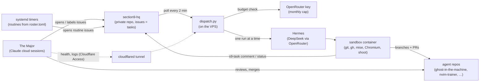

# Moving Section 9 off Paperclip, onto its own VPS

Status: plan, for Petter's review (31 Oct). Nothing here is built yet.

## Why
Paperclip cost more than it gave. In one week it caused:
- a false budget stop at 2% spend;
- an agent stuck "pausing" with no API to clear it;
- cost accounting that refuses to close runs Hermes can't price;
- a restart that silently cut every agent off from Hermes.

Each one needed database surgery. Hermes, the agents, the sandbox and the guardrails all worked. Petter has bought a separate VPS with Hermes (1 vCPU, 4 GB RAM, 50 GB disk), so Section 9 moves there. Paperclip is replaced by a small dispatcher plus a private GitHub repo as the task board.

flight-tracker stays on the Hetzner VM, which gets back the ~1.5 GB the agent stack used.

## The new shape

### Tasks: GitHub issues in a private repo
- **Board:** a new **private** repo `section9-hq`. It has to be private because some tasks are personal, like the rental watch.
- **One issue per task.** Labels carry the state:
  - `agent:<name>` says who has the task;
  - `status:todo`, `status:working`, `status:review`, `status:done` or `status:blocked` say where it is.
- **Agents report with `s9-task`,** the successor to `pc-task`: `s9-task --as Batou comment 12 -`, `s9-task --as Batou status 12 review "PR: …"`. It uses a fine-grained token that can only write issues in `section9-hq`, and it refuses to touch issues not labelled for that agent.
- **I manage tasks with `gh api`** on that repo: open, label, comment and close. There's no extra login and no tunnel, and GitHub keeps the history.
- **Routines** (nightly build, QA sweep, morning ops, rental watch) stay in `agents/roster.toml`. A systemd timer opens the issue at the given cron time. Rental-watch details stay out of this public repo: its brief lives in a root-only file on the VPS.

### The dispatcher (`vps/dispatch.py`, replaces Paperclip)
About 300 lines, standard-library Python, run by a systemd timer every 2 minutes. Each tick:
1. Finds `status:todo` issues with an `agent:` label, oldest first.
2. Checks spend. The run must fit under:
   - the OpenRouter key's monthly cap (the hard stop, enforced by OpenRouter);
   - the agent's monthly share from the roster (soft, enforced here, using the same token-weighted split `spend-report.py` already does).
   If a run wouldn't fit, it labels the issue `status:blocked` with the reason.
3. **Runs one task at a time.** That's all 1 vCPU can do, and it rules out the 30 Oct crash, which happened with two runs at once.
4. Calls Hermes's API with the agent's brief (`agents/*.md`) plus the issue text, and passes the timeout from the roster.
5. Labels the issue `status:working` at the start. If the run ends without the agent setting a status, the dispatcher labels it `status:blocked` and posts the run's last lines.
6. Never decides anything clever. A stuck run is killed at its timeout, and the issue is blocked with a note. No accounting states, no lifecycle holds.

Spend reports keep working as now:
- `spend-report.py` reads OpenRouter and writes the live snapshot into a pinned "Spend" issue on the board.
- The crew page's `crew-status.py` reads the board instead of Paperclip, with the same allowlist and the same private deny file.

### Reaching the VPS: cloudflared
- **Tunnel:** a named Cloudflare tunnel from the VPS to `ops.sectionnine.dev`, behind Cloudflare Access with a service token, the same way hq.sectionnine.dev works today.
- **Behind the tunnel:** a tiny read-only status endpoint from the dispatcher (queue, current run, last 50 log lines, memory, disk). The Major's check-in reads it.
- **SSH** also goes through the tunnel (`cloudflared access ssh`), for Petter.
- **Firewall:** the VPS firewall (ufw) allows nothing inbound. Hermes's API is never exposed: it listens on loopback for the dispatcher only.
- The Major doesn't need the tunnel to work. Tasks flow through GitHub; the tunnel is only for watching health.

### Updates: the VPS pulls, as the Hetzner VM does
`vm-sync.sh` carries over: it applies agent-manager `main` once CI is green, rebuilds the sandbox when its Dockerfile changes, and posts a line on a "Deploys" issue on the board. No inbound deploy access is needed.

## Memory and disk on 4 GB / 1 vCPU
| | Limit |
|---|---|
| OS, sshd, cloudflared, dispatcher | ~400 MB |
| Hermes | 1 GB (512 MB until 1 Nov: too small with the dashboard) |
| Sandbox (builds, one Chromium) | 2 GB, plus up to 2 GB swap |
| Free for page cache | ~1 GB |

- **Swap:** add a 4 GB swapfile.
- **Disk:** prune Docker images weekly (the same no-age-filter prune as #26), and keep the sandbox's toolchain cache under 15 GB.
- **CPU:** 1 vCPU makes Tachikoma's builds slower, so the nightly window stays 3 hours.

## Things to settle before building
1. **Reuse the existing secrets and tokens** (Petter, 31 Oct): the OpenRouter key, the agents' GitHub token and the Cloudflare Access service token. During phase 3 both machines spend from the one $20 cap, which the spend snapshot already shows as a single figure. At cutover, delete them from Hetzner instead of revoking them.
2. **Zero-data-retention (ZDR) routing for DeepSeek.**
   - The rule is that OpenRouter stays on ZDR endpoints. Hermes's OpenRouter provider settings must keep `data_collection: deny` and allow only providers that keep no data.
   - First step: check that DeepSeek's fast model has such a provider on OpenRouter. If none does, pick the nearest model that has one.
   - No xAI models, as before.
3. **The agents' GitHub token.** `section9-hq` is a new private repo. Adding it to the existing token's scope (issues only) needs Petter's OK.
4. **Hostinger's own Hermes install.**
   - Keep it as the reference config, but run our pinned compose: Hermes plus the sandbox, no Postgres, no Paperclip.
   - That keeps the guardrails: the sandbox user, the pre-push hook, `agents@sectionnine.dev`, digest pins, and the CI smoke test.

## Steps
**Phase 1, Petter on the VPS (about 30 min, a checklist in RUNBOOK):**
- **Accounts and hardening:**
  - create a non-root sudo user;
  - SSH keys only;
  - ufw: deny all inbound;
  - turn on unattended-upgrades;
  - add the 4 GB swapfile.
- **Software:** install Docker and cloudflared.
- **Tunnel:** `cloudflared tunnel login`, create the tunnel, and add an Access app for `ops.sectionnine.dev` that allows the existing service token.
- **The private repo:** create `section9-hq`, and add it to the agents' existing token with issue access.
- **Secrets:** copy the existing ones from Hetzner's `/etc/agent-manager/` into `/etc/section9/*.env` (root-only). Never in chat, never in a repo.
- **Bootstrap:** `git clone https://github.com/petterfranzen/agent-manager /opt/agent-manager && sudo /opt/agent-manager/vps/install.sh`

**Phase 2, the Major (a PR to agent-manager, reviewed with Saito):**
- `vps/compose.yaml`;
- `vps/dispatch.py` and `sandbox/s9-task`;
- systemd units, `vps/install.sh` and the status endpoint;
- spend and crew-status pointed at the board;
- `docs/check-in.md` and the scheduled check-in task updated together;
- tests against a stub GitHub and a stub Hermes, as for `spend-report.py`;
- the DECISIONS rows.

**Phase 3, moving over one at a time (about a week):**
1. **Ishikawa first.** Research is the lowest risk, and it covers the rental watch. Pause Ishikawa in Paperclip on the same day.
2. **Togusa and Saito,** and their routines.
3. **Batou.**
4. **Tachikoma last.** In Paperclip, the nightly routine is paused the same evening the VPS takes it, so there's never a double build.

**Phase 4, cutover:**
- On Hetzner, stop and remove the Paperclip, Postgres, Hermes and sandbox containers, and the spend, heal and crew-status timers.
- Keep Paperclip's last database backup for 30 days.
- Delete the copied secrets from Hetzner, revoke the Paperclip API keys, and retire the hq.sectionnine.dev Access app.
- Give flight-tracker back its memory headroom.
- **Rollback during phase 3:** un-pause the agent in Paperclip. After cutover: restore the backup and compose up on Hetzner.

## Done when
- A week of nights has run on the VPS with no manual fixes.
- The check-ins read the board and the VPS status page.
- Hetzner runs flight-tracker only.
- Every guardrail in CLAUDE.md still holds.
